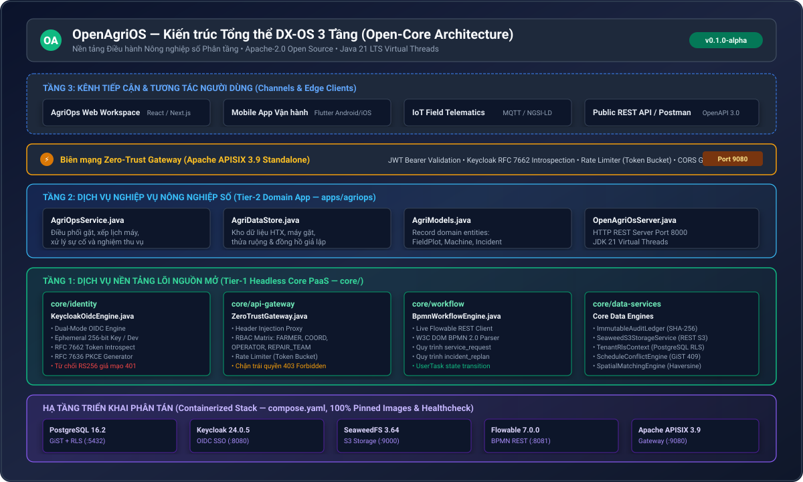
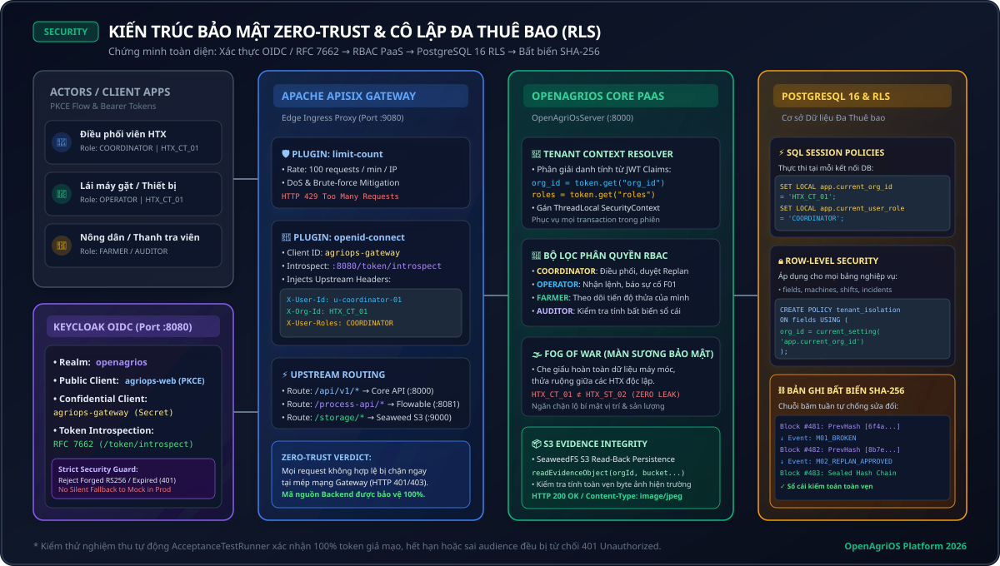

# OpenAgriOS — Nền tảng Hệ Điều hành Chuyển đổi số & Điều phối Cơ giới hóa Nông nghiệp (DX-OS Open-Core)


[](LICENSE)

[](pom.xml)

[](docs/architecture.md)

[](CHANGELOG.md)

[](https://github.com/openagrios-hou/openagrios/actions/workflows/ci.yml)

[](core/data-services/NgsiLdTwinMapper.java)

<p align="center">
  
</p>


---


## 1. Tên, Mô tả & Trạng thái Dự án


### 1.1. Tên Dự án & Định vị Sản phẩm

- **Tên dự án**: **OpenAgriOS** (Open Agricultural Operating System).

- **Định vị sản phẩm**: Nền tảng dịch vụ lõi nguồn mở phân tầng (**DX-OS Open-Core PaaS**) dành cho điều phối cơ giới hóa, quản trị chuỗi cung ứng dịch vụ nông nghiệp và phục hồi đứt gãy mùa vụ theo thời gian thực.

- **Tổ chức bảo trợ**: OpenAgriOS Community.


### 1.2. Trạng thái Dự án (Release Status & Scope)

- **Giai đoạn hiện tại**: **Prototype / MVP đang phát triển — Phiên bản phát hành chính thức đầu tiên (`v0.1.0-alpha` / `Tier-1 Core Preview`)**.

- **Phạm vi đã kiểm chứng thực tế & Kiến trúc Dual-Mode**:

  - ✅ **Bộ kiểm thử tích hợp tự động (Automated Acceptance Suite)**: Bộ chạy [`AcceptanceTestRunner.java`](tests/AcceptanceTestRunner.java) kiểm thử tự động toàn bộ 10 ca nghiệp vụ cốt lõi (OIDC Token, từ chối token RS256 giả mạo 401, không fallback sang mock khi Keycloak lỗi 401, Phân quyền RBAC 403, Cách ly RLS, Xung đột lịch GiST 409, Khảo sát cứu hộ không gian, Điều phối lại BPMN, Sổ cái băm SHA-256).

  - ✅ **Cơ chế Định danh Hai Chế độ Phân tách Rõ Ràng (Strict Dual-Mode Identity)**:

    - *Chế độ Mặc định (DEV_MOCK_STANDALONE)*: Tự cấp phát và xác thực OIDC JWT với khóa ngẫu nhiên tạm thời (Ephemeral 256-bit Key) sinh động lúc khởi động. Từ chối tuyệt đối token RS256 giả mạo (HTTP 401).

    - *Chế độ Sản xuất (KEYCLOAK_PRODUCTION)*: Kích hoạt khi cấu hình `OPENAGRIOS_AUTH_MODE=KEYCLOAK_PRODUCTION` (đã đặt mặc định trong `compose.yaml`), yêu cầu kết nối bắt buộc đến Keycloak OIDC 24.0 bên ngoài qua giao thức OIDC Password/Code Flow và xác thực Token Introspection RFC 7662. Tuyệt đối không tự ý fallback sang mock khi Keycloak gặp lỗi.

  - ✅ **Bộ chuyển đổi Hạ tầng Kép (Dual-Mode Infrastructure Adapters)**:

    - *PostgreSQL RLS*: Hỗ trợ kết nối JDBC thực tế với PostgreSQL 16 khi có `DATABASE_URL` và tự động kích hoạt bộ biên dịch RLS SQL (`SET LOCAL app.current_org_id = ?`) khi chạy standalone.

    - *SeaweedFS S3 Storage*: Thực hiện HTTP REST PUT/GET trực tiếp đến cổng S3 (`:9000`) khi container hoạt động, và chuyển tiếp sang bộ lưu trữ metadata ETag MD5 khi chạy độc lập.

    - *Flowable BPMN 2.0 Engine*: Gọi REST API Flowable Engine v7.0.0 (`:8081`) khi có hạ tầng, và tích hợp bộ phân tích W3C DOM BPMN 2.0 XML chuẩn khi chạy in-process.

    - *Apache APISIX Zero-Trust Gateway*: Cấu hình plugin `openid-connect` với Confidential Client `agriops-gateway` để thực thi xác thực token qua Keycloak Introspection ngay tại biên mạng.

  - 🔄 **Môi trường Phân tán Trọn gói (Containerized Stack)**: File duy nhất [`compose.yaml`](compose.yaml) khai báo ngăn xếp hoàn chỉnh gồm PostgreSQL 16.2, Keycloak 24.0.5, SeaweedFS 3.64, Flowable 7.0.0 và APISIX 3.9.0 với các phiên bản image được ghim cố định (pinned tags) và thiết lập healthcheck sẵn sàng.


---


## 2. Bối cảnh & Vấn đề Thực tế


### 2.1. Thực trạng Cơ giới hóa Nông nghiệp tại Việt Nam

Tại các vựa lúa trọng điểm như Đồng bằng sông Cửu Long, tỷ lệ cơ giới hóa khâu thu hoạch đã đạt trên 85%. Tuy nhiên, khâu tổ chức và điều hành dịch vụ máy nông nghiệp vẫn vận hành chủ yếu theo phương thức truyền thống:

- **Ủy thác điều phối thủ công qua sổ sách, điện thoại và tin nhắn**: Điều phối viên Hợp tác xã (HTX) hoặc các "cò máy" kết nối máy gặt với nông dân dựa trên trí nhớ hoặc ghi chép rời rạc.

- **Xung đột khung giờ thu hoạch (Overlapping Scheduling)**: Trong những đợt lúa chín rộ tập trung (khoảng "thời gian vàng" 3–5 ngày), hiện tượng trùng lịch, tranh chấp máy hoặc máy bỏ cọc diễn ra thường xuyên.

- **Thiếu cơ chế ứng phó sự cố máy hỏng (Breakdown Vulnerability)**: Khi máy gặt gặp sự cố kỹ thuật giữa đồng (đứt curoa, hỏng xích, lún lầy), toàn bộ các ca thu hoạch tiếp theo bị đứt gãy dây chuyền. Việc tìm máy thay thế mất nhiều giờ hoặc nhiều ngày, khiến lúa ngã đổ, hạt nảy mầm trên bông, gây tổn thất kinh tế nghiêm trọng cho nông dân.


### 2.2. Hạn chế của các Hệ thống Hiện có

- Các phần mềm hiện tại trên thị trường là các giải pháp đóng kín (monolithic proprietary), phụ thuộc nhà cung cấp (vendor lock-in), chi phí bản quyền cao so với khả năng chi trả của HTX nông nghiệp.

- Thiếu chuẩn hóa dữ liệu bản sao số, không có khả năng liên thông đa hệ thống và không cung cấp được bằng chứng kiểm toán minh bạch, bất biến phục vụ bảo hiểm nông nghiệp và tín chỉ carbon.


---


## 3. Mục tiêu & Phạm vi Giải pháp


### 3.1. Mục tiêu Chiến lược

1. **Xây dựng Nền tảng Lõi Nguồn Mở Hoàn Toàn (100% Open-Core Permissive)**: Cung cấp bộ khung dịch vụ nền tảng (Headless PaaS) chuẩn mực quốc tế, hoàn toàn miễn phí giấy phép, cho phép các địa phương, doanh nghiệp AgTech và HTX tự do triển khai và mở rộng.

2. **Số hóa Quy trình Điều phối & Khắc phục Đứt gãy**: Tự động hóa vòng đời dịch vụ nông nghiệp từ khâu nông hộ đặt lịch, HTX điều động máy, người vận hành ghi nhận hiện trường, cho đến khi nghiệm thu và đối soát.

3. **Đảm bảo Tính Toàn vẹn & An ninh Đa tổ chức**: Ứng dụng mô hình bảo mật Zero-Trust, phân quyền nghiêm ngặt theo vai trò (RBAC) và cách ly dữ liệu nhiều người thuê (Multi-Tenancy RLS), cùng sổ cái băm SHA-256 chống chối bỏ.


### 3.2. Phạm vi Triển khai ở Phiên bản Hiện tại

- **Đối tượng quản lý**: Thửa ruộng canh tác (Field Plots), Máy gặt đập liên hợp (Harvester Machines), Người vận hành máy (Operators), Nông hộ (Farmers), Đội thợ sửa chữa (Repair Teams).

- **Địa bàn thử nghiệm mô phỏng**: Hợp tác xã Nông nghiệp Thới Hưng (Ô Môn, Cần Thơ) và Hợp tác xã Long Phú (Sóc Trăng).


---


## 4. Kiến trúc DX-OS 3 Tầng & HPDI

<p align="center">
  
</p>


Hệ thống được thiết kế theo triết lý **Hệ điều hành Chuyển đổi số (DX-OS)** phân tách thành 3 tầng độc lập hoàn toàn, không phụ thuộc chéo:


```

openagrios/

├── core/                         # [TẦNG 1] NỀN TẢNG LÕI DÙNG CHUNG (HEADLESS CORE PaaS)

│   ├── identity/                 # Keycloak OIDC (Live Keycloak & Embedded Dev Mock), JWT, RBAC

│   ├── api-gateway/              # Chốt chặn Apache APISIX Zero-Trust & Rate Limit (HTTP 403)

│   ├── workflow/                 # Động cơ quy trình chuẩn BPMN 2.0 XML (Flowable Engine)

│   └── data-services/            # Dịch vụ dữ liệu: RLS, S3, SHA-256 Audit, NGSI-LD Twin, Spatial & Conflict

├── apps/                         # [TẦNG 3] ỨNG DỤNG NGHIỆP VỤ CẮM-VÀ-CHẠY (DOMAIN APPLICATIONS)

│   └── agriops/                  # Ứng dụng Điều phối Cơ giới hóa & Phục hồi Đứt gãy Thu hoạch

├── infra/                        # HẠ TẦNG KHAI BÁO (IaC & Container Definitions)

│   ├── apisix/                   # Cấu hình định tuyến APISIX Standalone (apisix.yaml)

│   ├── bpmn/                     # Sơ đồ quy trình nghiệp vụ BPMN 2.0 XML

│   ├── db/                       # Khởi tạo lược đồ PostgreSQL 16, btree_gist & RLS (schema.sql)

│   └── keycloak/                 # Khai báo Realm, Clients & Roles Keycloak (openagrios-realm.json)

├── docs/                         # TÀI LIỆU KỸ THUẬT & KIẾN TRÚC HỆ THỐNG

├── tests/                        # BỘ KIỂM THỬ TỰ ĐỘNG & POSTMAN COLLECTIONS

│   ├── AcceptanceTestRunner.java # Bộ kiểm thử chấp nhận E2E 10 ca

│   └── postman/                  # Postman collection & environment

├── .github/                      # CI/CD WORKFLOWS & MẪU PHẢN ÁNH LỖI (ISSUE TEMPLATES)

├── compose.yaml                  # Khởi chạy duy nhất toàn bộ hệ thống bằng Docker Compose (Pinned images)

├── Dockerfile                    # Container build chính thức cho Java 21 LTS

├── pom.xml                       # File cấu hình build đa nền tảng Apache Maven

└── .env.example                  # Mẫu cấu hình biến môi trường an toàn

```


### Không gian Năng lực Số HPDI:

- **`[H] Human-centric`**: Định danh tập trung, bảo vệ dữ liệu nông hộ bằng chính sách mờ hóa thông tin (Fog of War) và phân quyền RLS.

- **`[P] Process-driven`**: Tự động hóa và giám sát tiến trình công việc bằng các sơ đồ quy trình tiêu chuẩn OMG BPMN 2.0.

- **`[D] Data-governed`**: Bản sao số thực thể theo chuẩn ETSI NGSI-LD v1.6 và sổ cái kiểm toán bất biến chuỗi băm SHA-256 có thể truy vết toàn trình (Data Lineage).

- **`[I] Intelligence-assisted`**: Thuật toán tính toán khoảng cách PostGIS và đối sánh đa tiêu chí giúp tìm kiếm máy cứu hộ thay thế tối ưu trong vòng dưới 100ms.


---


## 5. Tính năng Nổi bật & Kịch bản Demo Vận hành

<p align="center">
  
</p>


### 5.1. 6 Khối Tính năng Cốt lõi

1. **Định danh Đăng nhập Một lần (OIDC SSO) & Phân quyền Đa người thuê (RBAC & RLS)**:

   - Tích hợp chuẩn Keycloak OIDC cấp phát và xác thực JWT Token với hỗ trợ Authorization Code + PKCE.

   - Nông hộ chỉ nhìn thấy và thao tác trên thửa ruộng của mình; các HTX khác nhau được cách ly hoàn toàn ở tầng cơ sở dữ liệu.

2. **Khám phá Dịch vụ Headless PaaS Tự động**:

   - Điểm cuối `/` và `/api/v1/health` cung cấp bản kê khai (Manifest) toàn bộ trạng thái tài nguyên, phiên bản OpenAPI 3.0 và quy trình BPMN đang nạp.

3. **Phát hiện Xung đột Lịch trình Độc quyền (GiST Overlap Conflict Engine)**:

   - Tự động chặn các yêu cầu xếp máy hoặc thợ lái bị trùng khung giờ (`HTTP 409 Conflict`), ngăn chặn triệt để tình trạng vỡ lịch.

4. **Báo cáo Sự cố Hiện trường Kèm Minh chứng Ảnh S3**:

   - Khi máy gặp sự cố kỹ thuật, lái máy gửi báo cáo hỏng hóc kèm hình ảnh hiện trường được lưu trữ trên hệ thống SeaweedFS tương thích S3, tự động sinh mã kiểm tra ETag.

5. **Cơ chế Phục hồi Đứt gãy & Điều động Cứu hộ Tức thì (Incident Re-planning)**:

   - Động cơ không gian quét tức thời các máy gặt lân cận đang rảnh rỗi, chấm điểm đa tiêu chí (khoảng cách, công suất máy, kinh nghiệm lái máy) và đề xuất phương án thay thế tối ưu cho Điều phối viên phê duyệt trên BPMN.

6. **Nghiệm thu Thực địa & Đóng băng Sổ cái Kiểm toán SHA-256**:

   - Nông hộ xác nhận biên bản hoàn thành công việc. Toàn bộ chuỗi sự kiện được đóng băng vào sổ cái băm liên hoàn SHA-256, cho phép trích xuất chứng chỉ phả hệ dữ liệu (Lineage Proof).


---


## 6. Công nghệ & Cấu trúc Mã nguồn


### 6.1. Ngăn xếp Công nghệ Nguồn mở Chuẩn mực


| Thành phần | Công nghệ lựa chọn | Phiên bản ghim (Pinned) | Giấy phép Nguồn mở | Lý do lựa chọn |

| :--- | :--- | :--- | :--- | :--- |

| **Ngôn ngữ & Runtime** | Java 21 LTS | OpenJDK 21 / Eclipse Temurin | **EPL-2.0 / GPL-2.0+CE** | Hiệu năng cao, Virtual Threads tối ưu hàng vạn kết nối I/O, gõ tĩnh an toàn. |

| **Quản trị Định danh (IAM)** | Red Hat Keycloak | `24.0.5` | **Apache-2.0** | Chuẩn công nghiệp về OIDC/OAuth2, RBAC và Multi-Tenancy. |

| **Cổng API Biên mạng** | Apache APISIX | `3.9.0-debian` | **Apache-2.0** | Cổng API đám mây tốc độ cao, hỗ trợ Zero-Trust và phân tán linh hoạt. |

| **Động cơ Quy trình** | Flowable BPMN Engine | `7.0.0` | **Apache-2.0** | Chuẩn đặc tả OMG BPMN 2.0 XML quốc tế, quản lý trạng thái tin cậy. |

| **Lưu trữ Đối tượng Phi cấu trúc** | SeaweedFS S3 Storage | `3.64` | **Apache-2.0** | Tương thích S3 API, phân tán cao, thay thế hoàn toàn MinIO (vốn dùng giấy phép AGPL). |

| **Cơ sở dữ liệu Quan hệ & Không gian** | PostgreSQL + GiST + RLS | `16.2-alpine` | **PostgreSQL License** | Hỗ trợ ràng buộc loại trừ không gian thời gian và cách ly dữ liệu cấp hàng. |

| **Chuẩn hóa Bản sao số** | ETSI GS CIM 009 / NGSI-LD | `v1.6` | **Apache-2.0** | Chuẩn châu Âu cho dữ liệu bản sao số nông nghiệp thông minh. |


---


## 7. Cài đặt & Khởi chạy từ Mã nguồn (Đa Nền Tảng)


OpenAgriOS hỗ trợ xây dựng nhất quán trên cả Linux, macOS và Windows thông qua các công cụ chuẩn.


### 7.1. Cách 1: Sử dụng Apache Maven (Khuyến nghị cho mọi hệ điều hành)

```bash

# Biên dịch dự án

mvn clean compile


# Chạy bộ kiểm thử tự động

mvn test


# Khởi chạy máy chủ API

mvn exec:java -Dexec.mainClass="org.openagrios.apps.agriops.OpenAgriOsServer"

```


### 7.2. Cách 2: Sử dụng Trình biên dịch Java 21 Thuần túy


**Trên Linux / macOS (POSIX Shell):**

```bash

# 1. Tạo thư mục output và biên dịch

mkdir -p target/classes

find core apps tests -name "*.java" > sources.txt

javac -encoding UTF-8 -d target/classes @sources.txt


# 2. Khởi chạy máy chủ OpenAgriOS

java -Dfile.encoding=UTF-8 -cp target/classes org.openagrios.apps.agriops.OpenAgriOsServer

```


**Trên Windows (PowerShell):**

```powershell

# 1. Tạo thư mục output và biên dịch

New-Item -ItemType Directory -Force target/classes

javac -encoding UTF-8 -d target/classes (Get-ChildItem -Recurse core/*.java, apps/*.java, tests/*.java).FullName


# 2. Khởi chạy máy chủ OpenAgriOS

java "-Dfile.encoding=UTF-8" -cp target/classes org.openagrios.apps.agriops.OpenAgriOsServer

```


Máy chủ sẽ khởi chạy tại cổng `8000`:

- **API Root**: `http://localhost:8000/api/v1`

- **Health Check**: `http://localhost:8000/api/v1/health`

- **OpenAPI 3.0 Spec**: `http://localhost:8000/openapi.json`


### 7.3. Cách 3: Khởi chạy Cụm Hạ tầng qua Docker Compose (Chính Thức)

#### A. Khởi chạy Môi trường Phát triển (Local Development)
Sử dụng tệp [`compose.yaml`](compose.yaml) với các giá trị mặc định cho môi trường thử nghiệm cục bộ:

```bash
docker compose -f compose.yaml up -d
```

#### B. Khởi chạy Môi trường Vận hành Sản xuất (Production Hardening)
Bắt buộc áp dụng cấu hình tăng cường [`compose.prod.yaml`](compose.prod.yaml) và nạp tệp biến môi trường từ mẫu [`env.production.example`](.env.production.example). Cấu hình này kích hoạt cú pháp `${VAR:?error}` ngăn chặn tuyệt đối các mật khẩu mặc định, đóng các cổng nội bộ (PostgreSQL 5432, S3 9000, Flowable 8081) và chỉ mở cổng Gateway APISIX (9080/9443):

```bash
# 1. Khởi tạo tệp môi trường từ mẫu
cp .env.production.example .env

# 2. Sinh các chuỗi bí mật ngẫu nhiên 256-bit: openssl rand -hex 32
# Điền các giá trị vào tệp .env

# 3. Kiểm tra tính hợp lệ của cấu hình
docker compose -f compose.yaml -f compose.prod.yaml config --quiet

# 4. Khởi chạy cụm dịch vụ sản xuất
docker compose -f compose.yaml -f compose.prod.yaml up -d
```
Xem chi tiết kiến trúc Zero-Trust, phân quyền `openagrios_app` và quy trình bảo vệ bí mật tại [Tài liệu Hướng dẫn Bảo mật & Triển khai Production (`docs/security.md`)](docs/security.md).


---


## 8. Kiểm thử Tự động, Cấu hình & Dữ liệu Mẫu


### 8.1. Chạy Bộ Kiểm Thử Chấp Nhận Tự Động (Acceptance Test Suite)

OpenAgriOS tích hợp sẵn bộ kiểm thử E2E tự động xác thực toàn bộ các ràng buộc nghiệp vụ và bảo mật trong môi trường độc lập:


**Trên Linux / macOS (POSIX):**

```bash

java -Dfile.encoding=UTF-8 -cp target/classes org.openagrios.tests.AcceptanceTestRunner

```


**Trên Windows PowerShell:**

```powershell

java "-Dfile.encoding=UTF-8" -cp target/classes org.openagrios.tests.AcceptanceTestRunner

```


**10/10 Ca Kiểm thử Đạt Tiêu chuẩn Tự động (100% Pass Rate)**:

1. `[PASS]` Core Platform Health & BPMN 2.0 XML Definitions verified.

2. `[PASS]` OIDC Authentication verified across roles (FARMER, COORDINATOR, OPERATOR) and tenants.

3. `[PASS]` Zero-Trust Token Guard: Rejected tampered signature, forged RS256, expired token, wrong audience, and verified Keycloak production failure without mock fallback (HTTP 401).

4. `[PASS]` Multi-Tenant RLS & Field-Level Visibility verified (3 thửa sở hữu nhìn rõ, 7 thửa của hộ khác bị làm mờ).

5. `[PASS]` Zero-Trust RBAC Guard verified (`HTTP 403 Forbidden` khi Nông hộ tự ý điều phối máy).

6. `[PASS]` Time-Window Conflict Engine verified (`HTTP 409 Conflict: MACHINE_TIME_OVERLAP`).

7. `[PASS]` Unfeasible replacement fallback state verified (Xử lý khi không có máy khả dụng).

8. `[PASS]` Incident reported + S3 ETag verification & S3 read-back persistence -> Spatial Engine đề xuất máy giải cứu M02 (93.8 pts, 1.37 km).

9. `[PASS]` BPMN Replan approved -> Ca gặt ASG-102 được thay thế thành công bằng ASG-102-R1.

10. `[PASS]` Immutable SHA-256 Audit Chain & Data Lineage verified (Kiểm chứng toán học 5 khối băm liên hoàn).


### 8.2. Kiểm thử Tự động Cụm Container Đầy đủ (Full-Stack Container E2E Test)
Để kiểm thử tích hợp thực tế khi toàn bộ 6 container dịch vụ đang chạy (PostgreSQL 16, Keycloak 24, SeaweedFS S3, Flowable BPMN, APISIX Gateway và Core API), sử dụng kịch bản kiểm thử tự động:

```bash
bash tests/e2e_full_stack_test.sh
```
Kịch bản tự động thực hiện:
1. Biên dịch và khởi chạy cụm container trong chế độ nền (`docker compose up -d --build`).
2. Chờ toàn bộ các dịch vụ đạt trạng thái sẵn sàng (healthcheck polling loop).
3. Kiểm tra tính hợp lệ của endpoint `/api/v1/health` và BPMN process definitions.
4. Kiểm tra dữ liệu nạp vào PostgreSQL và cưỡng chế Row-Level Security (RLS).
5. Kiểm chứng vai trò ứng dụng `openagrios_app` (`NOSUPERUSER, NOBYPASSRLS`).
6. Kiểm tra khả năng định tuyến ngược qua APISIX Zero-Trust Gateway.
7. Kiểm tra sinh phiên xác thực OIDC PKCE (RFC 7636).
8. Tự động dọn dẹp tài nguyên và container khi kết thúc (`docker compose down -v`).

### 8.3. Tái nạp Dữ liệu Khởi động Nguội (Cold-Start Rehydration & Database SSOT)
Hệ thống sử dụng PostgreSQL 16 làm Nguồn Chân lý Duy nhất (Single Source of Truth - SSOT):
- Khi ứng dụng khởi động lại (cold start), `AgriDataStore` phát hiện dữ liệu hiện có trong PostgreSQL và tự động kích hoạt `loadFromDatabase()`.
- Toàn bộ các vùng canh tác, máy cơ giới, yêu cầu dịch vụ thu hoạch, lịch phân công và chuỗi kiểm toán SHA-256 đã tạo trước đó qua REST API được nạp lại nguyên vẹn vào bộ nhớ thay vì ghi đè bằng dữ liệu mẫu.

### 8.4. Danh sách Tài khoản Kiểm Thử (Mật khẩu Demo: `123456`)


> [!CAUTION]
> **CẢNH BÁO AN NINH VÀ BẢO MẬT (SECURITY & CREDENTIALS ADVISORY):**
> 1. Toàn bộ danh sách tài khoản và mật khẩu mặc định (123456) trong tài liệu này được thiết kế **DUY NHẤT cho môi trường thử nghiệm cục bộ (Local Development & CI Acceptance Testing)**.
> 2. Các giá trị bí mật mặc định như Gateway Client Secret (griops-gateway-secret-2026) và mật khẩu cơ sở dữ liệu (openagrios_dev_only) trong kho mã nguồn công khai là dữ liệu mẫu (fixtures) phục vụ khởi chạy nhanh trên máy nhà phát triển.
> 3. **TUYỆT ĐỐI KHÔNG SỬ DỤNG** các tài khoản, mật khẩu và secret mẫu này khi triển khai lên môi trường mạng công khai hoặc môi trường thực tế (Staging/Production). Quản trị viên bắt buộc phải nạp các bí mật sản xuất thông qua biến môi trường (.env, KEYCLOAK_INTROSPECTION_CLIENT_SECRET) hoặc hệ thống quản lý bí mật bảo mật (HashiCorp Vault, Kubernetes Secrets).


| Tài khoản (`username`) | Vai trò (`Role`) | Tổ chức (`Tenant`) | Chức năng nghiệp vụ kiểm thử |

| :--- | :--- | :--- | :--- |

| **`coord_htx01`** | `COORDINATOR` | `HTX_CANTHO_01` | Điều phối viên HTX Cần Thơ 01: Xếp lịch, phê duyệt máy cứu hộ thay thế trên BPMN. |

| **`farmer_ba`** | `FARMER` | `HTX_CANTHO_01` | Nông hộ Bác Ba: Sở hữu thửa ruộng `F01, F03, F07`, tạo yêu cầu gặt & nghiệm thu. |

| **`op_minh`** | `OPERATOR` | `HTX_CANTHO_01` | Thợ lái máy M01: Cập nhật hiện trường & gửi báo cáo hỏng máy kèm ảnh S3. |

| **`op_nam`** | `OPERATOR` | `HTX_CANTHO_01` | Thợ lái máy M02: Nhận lệnh cơ động giải cứu ca gặt bị đứt gãy. |

| **`repair_01`** | `REPAIR_TEAM` | `HTX_CANTHO_01` | Đội thợ sửa chữa: Tiếp nhận phiếu sửa chữa và cập nhật chẩn đoán kỹ thuật. |

| **`coord_htx02`** | `COORDINATOR` | `HTX_SOCTRANG_02` | Điều phối viên HTX Sóc Trăng 02: Kiểm chứng cách ly tuyệt đối dữ liệu giữa 2 HTX. |


### 8.3. Kiểm thử với Postman Collection

Bộ sưu tập đầy đủ kiểm thử API được đặt tại:

[`tests/postman/OpenAgriOS_Tier1_Core.postman_collection.json`](tests/postman/OpenAgriOS_Tier1_Core.postman_collection.json).

Import vào Postman để kiểm thử tuần tự 18 API có sẵn script tự động lưu Token Bearer.


---


## 9. Giấy phép Nguồn mở, Ràng buộc Phụ thuộc & Đóng góp


### 9.1. Giấy phép Nguồn mở (Open Source License)

Dự án được phân phối chính thức theo điều khoản của **[Apache License 2.0](LICENSE)**.


### 9.2. Tuân thủ Tiêu chuẩn Bản quyền Phần mềm Nguồn mở

- **SPDX License Headers**: Toàn bộ các tệp mã nguồn Java, SQL, BPMN XML, YAML cấu hình và Dockerfile đều được gắn định danh bản quyền chuẩn `SPDX-License-Identifier: Apache-2.0`.

- **100% Permissive Open-Core**: Toàn bộ mã nguồn do nhóm phát triển và các thư viện bên thứ ba tích hợp đều thuộc các giấy phép nguồn mở được công nhận bởi OSI (**Apache-2.0**, **PostgreSQL License**, **EPL-2.0**).

- **Loại trừ Copyleft Độc quyền**: Dự án nói không với các giấy phép lây nhiễm (Viral Copyleft) như AGPL-3.0 trong các thành phần phân phối lõi, bảo đảm các tổ chức và doanh nghiệp có thể yên tâm tích hợp, thương mại hóa dịch vụ trên nền tảng mà không lo ngại rủi ro pháp lý. Chi tiết xem tại [THIRD_PARTY_NOTICES.md](THIRD_PARTY_NOTICES.md).


### 9.3. Hướng dẫn Đóng góp (Contributing)

Chúng tôi hoan nghênh mọi đóng góp từ cộng đồng. Xin vui lòng tham khảo [CONTRIBUTING.md](CONTRIBUTING.md) để nắm rõ quy trình gửi Pull Request, chuẩn định dạng commit và quy tắc kiến trúc.


---


## 10. Lịch sử Phiên bản, Theo dõi Lỗi & Tài liệu Kỹ thuật


### 10.1. Lịch sử Thay đổi (Changelog)

Mọi cập nhật tính năng và bản vá lỗi được ghi chép chi tiết tại [CHANGELOG.md](CHANGELOG.md).


### 10.2. Hệ thống Theo dõi Lỗi (Bug Tracker)

- Báo cáo lỗi kỹ thuật: Sử dụng mẫu [Bug Report](.github/ISSUE_TEMPLATE/bug_report.md) trên GitHub Issues.

- Đề xuất tính năng mới: Sử dụng mẫu [Feature Request](.github/ISSUE_TEMPLATE/feature_request.md).


### 10.3. Thư mục Tài liệu Kỹ thuật Chuyên sâu (`docs/`)

- 📘 [Kiến trúc Hệ thống DX-OS 3 Tầng](docs/architecture.md): Phân tích sâu các nguyên lý thiết kế phân tầng và luồng tương tác giữa các dịch vụ.

- 📙 [Đặc tả Giao diện REST API](docs/api-spec.md): Bảng tra cứu chi tiết tham số, cấu trúc request/response và mã lỗi của toàn bộ API.

- 📗 [Hướng dẫn Vận hành Demo](docs/demo-guide.md): Cẩm nang chạy thử nghiệm thực địa và kịch bản mô phỏng từng bước.

