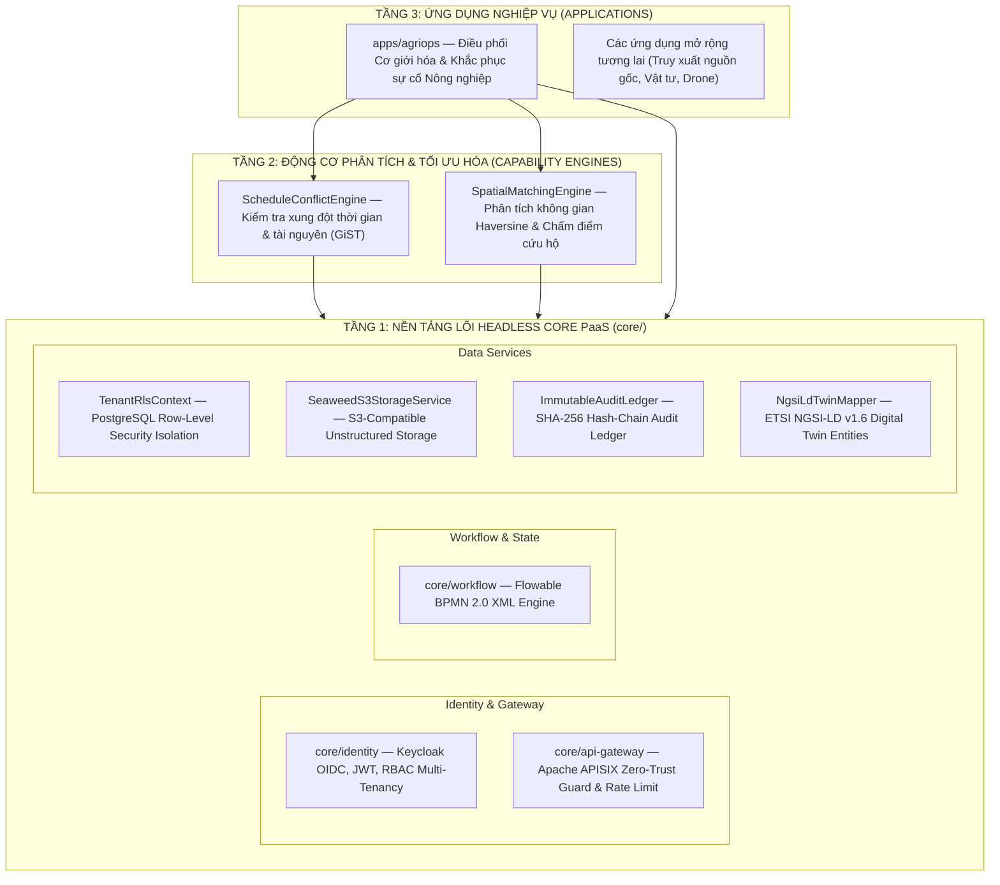

# OpenAgriOS — Kiến Trúc Hệ Thống (DX-OS Open-Core 3 Tầng)

OpenAgriOS được thiết kế theo triết lý **DX-OS Open-Core (Digital Transformation Operating System)**: tách bạch hoàn toàn giữa **Nền tảng lõi dùng chung (Headless Core PaaS)**, **Động cơ phân tích tính toán (Capability Engines)** và **Ứng dụng nghiệp vụ chuyên ngành cắm-và-chạy (Plug-and-Play Domain Apps)**.

---

## 1. Mô hình Kiến trúc Tổng thể 3 Tầng

  

---

## 2. Chi tiết các Phân hệ Tầng 1 (Core Platform)

### 2.1. `core/identity` — Quản trị Định danh & Phân quyền (IAM)
- **Chuẩn công nghệ**: OpenID Connect (OIDC 1.0) & OAuth 2.0 trên nền Keycloak 24.0.
- **Cơ chế hoạt động**:
  - Cấp phát và xác thực chữ ký số JSON Web Token (JWT Bearer Token) đối xứng HMAC-SHA256.
  - Hỗ trợ đa tổ chức đa người thuê (Multi-Tenancy) với mã định danh tổ chức `organization_id` nhúng trực tiếp trong JWT claims.
  - Phân quyền theo vai trò (Role-Based Access Control - RBAC): `COORDINATOR`, `FARMER`, `OPERATOR`, `MACHINE_OWNER`, `REPAIR_TEAM`.

  

### 2.2. `core/api-gateway` — Cổng API Biên mạng Zero-Trust
- **Chuẩn công nghệ**: Kiến trúc tương thích Apache APISIX 3.9 Cloud-Native API Gateway.
- **Cơ chế hoạt động**:
  - Không tin tưởng bất kỳ yêu cầu nào khi chưa qua xác thực (Never Trust, Always Verify).
  - Tự động kiểm tra tính hợp lệ của Token, phân giải context người dùng và gắn các Zero-Trust Headers (`X-Consumer-Username`, `X-Consumer-Role`, `X-Tenant-Id`, `X-Zero-Trust-Passed`).
  - Chặn đứng mọi hành vi vượt quyền ở tầng biên mạng với mã lỗi chuẩn `HTTP 403 Forbidden`.

### 2.3. `core/workflow` — Động cơ Quy trình Nghiệp vụ BPMN 2.0
- **Chuẩn công nghệ**: Flowable / Camunda XML BPMN 2.0 Spec (OMG Standard).
- **Cơ chế hoạt động**:
  - Định nghĩa quy trình bằng tệp XML chuẩn hóa (`infra/bpmn/service_request.bpmn20.xml` và `infra/bpmn/incident_replan.bpmn20.xml`).
  - Quản lý vòng đời trạng thái quy trình tự động: khởi tạo instance, lưu lịch sử chuyển bước, thực thi các cổng rẽ nhánh điều kiện (Exclusive Gateway), và đóng tiến trình khi hoàn thành.

### 2.4. `core/data-services` — Dịch vụ Dữ liệu Hợp nhất
- **Cách ly dữ liệu người thuê (RLS)**: Tự động biên dịch chính sách phân quyền Row-Level Security theo chuẩn PostgreSQL 16, đảm bảo Nông hộ chỉ thấy dữ liệu thửa ruộng của mình, Hợp tác xã chỉ thấy dữ liệu thành viên, và các tổ chức khác biệt hoàn toàn bị cô lập.
- **Sổ cái Bất biến SHA-256**: Ghi nhận tuần tự mọi biến động trạng thái (state transition) bằng chuỗi khối băm SHA-256 (`prev_hash` -> `record_hash`). Hỗ trợ hàm kiểm tra toàn vẹn chuỗi và truy vết phả hệ dữ liệu (Data Lineage) theo mã giao dịch liên kết `correlation_id`.
- **Lưu trữ Tệp S3**: Dịch vụ lưu trữ đối tượng phi cấu trúc tương thích S3 API (SeaweedFS), tự động tính mã ETag (MD5/SHA) và lưu vết bằng chứng hiện trường (ảnh hỏng máy, ảnh nghiệm thu).
- **Bản sao số NGSI-LD**: Ánh xạ dữ liệu máy móc và cảm biến sang định dạng thực thể ETSI GS CIM 009 / FIWARE Smart Data Models với cấu trúc `Property`, `observedAt`, `unitCode`, và vị trí địa lý chuẩn GeoJSON.

---

## 3. Khả năng Mở rộng và Độc lập của Lõi

Hệ thống tuân thủ nguyên tắc **Dependency Inversion**:
- Lõi `core/` không phụ thuộc vào bất kỳ nghiệp vụ cụ thể nào của lúa gạo hay cơ giới hóa nông nghiệp.
- Mọi mô hình dữ liệu nông nghiệp được đóng gói gọn trong `apps/agriops`.
- Khi cần phát triển các nghiệp vụ mới (quản lý phân bón, máy bay không người lái phun thuốc, chuỗi cung ứng logistics), lập trình viên chỉ cần tạo module mới trong `apps/` và tái sử dụng toàn bộ Tầng 1 Core PaaS mà không cần viết lại hạ tầng.
